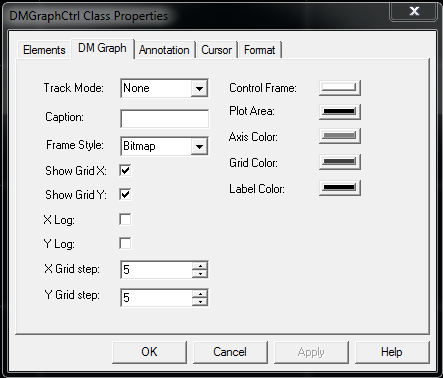

   

* * *

-   [Download demo - 328 KB](img/DmGraph.zip)
-   [Download source code - 108 KB](img/DmGraph_src.zip)

[](img/Real-Time-Plot-graph-control.PNG "Click to enlarge")

## Introduction

Quite often developers need to plot various data. They expect to use a light control with minimal dependencies.

## Background

[NTGraph](ntgraph_activex.aspx) control is a powerful ActiveX control which plots multiple data sets. Unfortunately it depends on MFC libraries.

This new 2D Graph ActiveX control, named DMGraph, is based on the NTGraph drawing engine but eliminates the MFC dependency. For DMGraph, ATL 3.0 was used as the framework. The only dependencies are some MS Windows DLLs (the C runtime library _msvcrt.dll_ is part of the OS starting with Windows 2000). This means there are no deployment issues - DMGraph works on Windows 2000 or later.

Another major change compared with old `NTGraphCtrl` is the exposed COM interface architecture. Instead of putting everything together under one interface, `DMGraphCtrl` exposes a hierarchy of interfaces which represents entities used on drawing.

## Using the code

The main interface `IDMGraphCtrl` contains collections of items (managed by the `IDMGraphCollection` interface). This collection interface exposes the usual methods (such as `Add`, `Delete`, `Count`, `Item`). What is specific is the concept of "selected item". One item in the collection can be the "selected" one. Sometimes user operations (such as mouse drag) apply to the "selected" item (if any). The `IDMGraphCollection::Selected` property gets/sets the index of the selected item.

When the user double clicks the graph area, a modal dialog with property pages is displayed. This dialog may be invoked programmatically as well using the `ShowProperties` method. Modifying data in these property pages has an immediate effect on the displayed graph.

The `CDMGraphCtrl` class implements the `IDMGraphCtrl` interface. At runtime, some properties can be viewed or changed using the DM Graph property page:



The `CDMGraphCtrl` class keeps the following collections exposed by the `IDMGraphCtrl` interface:

### 1\. Element collection

The `get_Elements` property exposes the elements collection.

Each item is an instance of the `CGraphElement` class which exposes the `IDMGraphElement` interface. A graph element is a collection of points which need to be plotted. The graph element has various properties which define its drawing style. For example, the `Linetype` property defines what kind of line should be used to connect the points (including "Null" - no lines at all). Color, width, shape can be set for points; the entire set of points can be enabled/disabled for drawing, etc. Each graph element is identified by a "name". All these are accessible through COM properties exposed by the `IDMGraphElement` interface. When such a property is set, the entire graph is re-drawn to reflect the changes.

The set of points (data to be plotted) is supplied by the client using several methods:

-   `Plot` - two one-dimensional arrays with same size (one for X, the other for Y) will set the entire point collection for a specific graph element.
-   `PlotXY` - appends just one point to the point collection (both X and Y coordinates are specified).
-   `PlotY` - appends just one point to the point collection (only Y is specified, the X is the index of the added point in the points collection).

Each time the point collection is modified, the graph is updated to reflect the changes but the range is not updated. If the new point(s) go(es) out of range, then the `SetRange` or `AutoRange` methods need to be called.

New elements can be added to the collection, existing ones removed, selected element index can be changed, and selected element properties can be viewed/changed from the Elements property page.


### 2\. Annotation collection

The `get_Annotations` property exposes the annotations collection.

One annotation is a piece of text which is displayed on a specific position on the graph. This collection keeps instances of the `CGraphAnnotation` class which exposes the `IDMGraphAnnotation` interface. Using this interface various properties can be accessed - such as caption (the displayed text), position, color, text orientation, background enable/disable. When such a property is set, the entire graph is re-drawn to reflect the changes.

New annotations can be added to the collection, existing ones removed, selected annotation index can be changed, and selected annotation properties can be viewed/changed from the Annotations property page.


### 3\. Cursor collection

The `get_Cursors` property exposes the cursors collection.

A cursor is made of one or two lines which are parallel with the X or Y axis. The `IDMGraphCursor` interface deals with cursor specific properties. If the `Style` property (type is the `Crosshair` enum) is set to "XY" then the cursor will have two lines: one parallel with X axis and the other parallel with Y axis. If the cursor `Mode` is set to `Snap`, then the selected cursor will snap to the closest point of the selected graph element during mouse drag.

New cursors can be added to a collection, existing ones removed, selected cursor index can be changed, and selected cursor properties can be viewed/changed from the Cursors property page.


### 4\. Axis objects

Two objects are exposed by the `get_Axis` property: one for X (horizontal) axis and the other for Y (vertical) axis. The objects are instances of the `CGraphAxis` class which exposes the `IDMGraphAxis` interface. Various properties can be get/set for each axis. If the `put_Time` property is set to `VARIANT_TRUE`, then the double values for that axis are considered to be date/time values. These values are interpreted like the `DATE` type (used in OLE Automation `VARIANT` union). The values are displayed according to the format string set by the `Format` property. For date/time, possible format strings are documented in the `strftime` function in MSDN. Otherwise, for non logarithmic axis, the usual `sprintf` format strings are accepted. Some axis properties are available in the DM Graph property sheet (see above) while others are available in the Format property page (see below).


From the Axis combo box, the X (bottom) or Y (left) axis can be selected. Then the data type can be set for the selected axis. For each type, the Templates list box is filled with the available format templates. When a template item is selected from the left, the Format string on the right is updated.

## Basic usage

### 1\. From a Windows client written in C++ with ATL

```cpp
class CMainWnd : public CWindowImpl<CMainWnd>
{ 
     CAxWindow*                 m_pGraphCtrl; 
     CComPtr<IDMGraphCtrl>      m_spDMGraph; 
}; 

LRESULT CMainWnd::OnCreate(UINT uMsg, WPARAM wParam, LPARAM lParam, BOOL& bHandled)  
{ 
     m_pGraphCtrl = new CAxWindow; 
     if(m_pGraphCtrl == NULL) 
           return -1; 
     if(!AtlAxWinInit()) 
           return -1; 
     HRESULT hr; 
     CComPtr<IAxWinHostWindow> spHost; 
     hr = m_pGraphCtrl->QueryHost(IID_IAxWinHostWindow, (void**)&spHost); 
     if(FAILED(hr)) 
     { 
         Message(hr, NULL, L"Cannot query Ax host"); 
         return -1; 
     } 
     hr = spHost->CreateControl(L"DMGraph.DMGraphCtrl", m_pGraphCtrl->m_hWnd, NULL); 
     if(FAILED(hr)) 
     { 
         Message(hr, NULL, L"Cannot start DM Graph control"); 
         return -1; 
     } 

     CComVariant vData; 
     hr = m_pGraphCtrl->QueryControl(IID_IDMGraphCtrl, (void**)&m_spDMGraph); 
     if(FAILED(hr) || m_spDMGraph == NULL) 
     { 
         Message(hr, NULL, L"Cannot query DM Graph control"); 
         return -1; 
     } 
     return 0;
}  
 
void CMainWnd::SetGraphData(VARIANT* pvarrX, VARIANT* pvarrY, LPCTSTR szName)
{ 
  ATLASSERT(pvarrX); 
  ATLASSERT(pvarrY); 
  ATLASSERT(szName); 
  CComBSTR bsName(szName); 
  CComPtr<IDMGraphCollection> spElements; 
  CComPtr<IDMGraphElement> spGraphElement; 
  HRESULT hr = m_spDMGraph->get_Elements(&spElements); 
  long i, nElementCount = 0; 
  BOOL bReplace = FALSE; 
  hr = spElements->get_Count(&nElementCount); 
  for(i=0; i<nElementCount; i++) 
  { 
     CComBSTR bsElemName; 
     CComPtr<IDispatch> spDispatch; 
     
     hr = spElements->get_Item(i, &spDispatch); 

     hr = spDispatch.QueryInterface(&spGraphElement); 

     spGraphElement->get_Name(&bsElemName); 
     if(_wcsicmp(bsElemName, bsName) == 0) 
    { 
         OLECHAR szMsgText[256]; 
        _snwprintf(szMsgText, 256,
              L"There is ALREADY an element named '%s'.\n"
              L"Do you want to replace it ?", bsElemName); 
         if(::MessageBoxW(m_hWnd, szMsgText, NULL,
            MB_YESNO|MB_ICONQUESTION) != IDYES)
         { 
              return;
         } 
         bReplace = TRUE; 
         break; 
    } 
    else 
         spGraphElement = NULL; 
  } 
  if(bReplace == FALSE || spGraphElement == NULL) 
  { 
     CComPtr<IDispatch>     spDispatch; 
     hr = spElements->Add(&spDispatch); 
     spGraphElement = NULL; 
     hr = spDispatch.QueryInterface(&spGraphElement); 

  } 
  hr = spGraphElement->put_Name(bsName); 
  hr = spGraphElement->put_PointSymbol( Dots ); 
  hr = spGraphElement->put_PointSize(3); 
  hr = spGraphElement->Plot(*pvarrX, *pvarrY); 
  if(FAILED(hr)) 
  { 
     Message(hr, spGraphElement, L"Failed to plot items");
     return; 
  } 
  hr = m_spDMGraph->AutoRange(); 
}
```

### 2\. From an HTML page using VBScript

Inside the HTML body, the ActiveX is created using the `object` tag. A button click will execute a script to set the data to be plotted.

```html
<object ID="DMGraphCtrl" 
      CLASSID="CLSID:AAF89A51-7FC0-43B0-9F81-FFEFF6A8DB43" 
      width=600 height=400 VIEWASTEXT></object>
<input id=BtnSin value=sin type="button">
<script id=clientEventHandlersVBS language="vbscript">
<!--
Sub BtnSin_onclick
  On Error Resume Next
  Dim dmGraphCtrl
  Set dmGraphCtrl = document.getElementById("DMGraphCtrl")
  Dim idx : idx = dmGraphCtrl.Elements.Selected
  If idx < 0 Then
    MsgBox("Error: please create and select an element first." &_
             vbCrLf & "(Double click to see property pages)")
  Else
    Dim selElement
    Set selElement = dmGraphCtrl.Elements.Item(idx)
    Dim i
    Dim x()
    Dim y()
    ReDim x(100)
    ReDim y(100)
    For i=0 To 100
      x(i) = i/5
      y(i) = Sin( x(i) )
    Next
    selElement.Plot x, y
    dmGraphCtrl.AutoRange()
  End If
  If Err.number <> 0 Then
    MsgBox Err.Description
  End If
End Sub
-->
</script>
```

### 3\. From a Windows client written in C++ with MFC

```cpp
#import "..\DMGraph\DMGraph.tlb" no_namespace raw_interfaces_only

class CDmGraphMfcClientDlg : public CDialog
{
    ... ... ...

    IDMGraphCtrlPtr m_spGraph;
};

BOOL CDmGraphMfcClientDlg::OnInitDialog()
{
    ... ... ...

    CWnd* pwndCtrl = GetDlgItem(IDC_DMGRAPHCTRL1);
    ASSERT_VALID(pwndCtrl);
    IUnknown* pUnkCtrl = pwndCtrl->GetControlUnknown(); //weak reference

    HRESULT hr;
    m_spGraph = pUnkCtrl;
    IDMGraphCollectionPtr colElements;
    
    hr = m_spGraph->get_Elements(&colElements);

    IDispatchPtr spDisp;
    IDMGraphElementPtr spElem;
    hr = colElements->Add(&spDisp);
    spElem = spDisp;
    hr = spElem->put_Name(_bstr_t("sin"));
    hr = spElem->put_PointSymbol( Dots );
    hr = spElem->put_PointSize(1);
    hr = spElem->put_PointColor( RGB(255, 0, 0) );
    
    COleSafeArray arrx, arry;
    arrx.CreateOneDim(VT_R8, 100);
    arry.CreateOneDim(VT_R8, 100);
    long i;
    for(i=0; i<100; i++)
    {
        double x, y;
        x = i/10.;
        y = sin(x);

        arrx.PutElement(&i, &x);
        arry.PutElement(&i, &y);
    }

    hr = spElem->Plot(COleVariant(arrx), COleVariant(arry));
    hr = m_spGraph->AutoRange();

    return TRUE;  // return TRUE  unless you set the focus to a control
}
```

## Points of interest

-   The "`sprintf`" code which formats the input data needs to be guarded against exceptions.
-   The `WM_ERASEBKGND` needs to be handled to avoid window flickering while resizing.
-   The `VARIANT` passed by a VBScript client usually needs indirection for contained safe array and conversion for array elements.

## History

-   Version 5.0.0.3

-   Corrected a registration error (wrong LIBID was used inside CLSID key)
-   Added the "control" flag for the type library (as attribute in IDL). In this way DMGraph is listed as an ActiveX in Visual Basic Component Control List / Excel Control Toolbox
-   Changed the DrawGraphOffScreen function to behave properly even if the supplied HDC is a metafile DC. This is useful when COM client invokes IDataObject::GetData method. The ATL implementation for this method uses a metafile DC.

-   Version 5.0.0.2

-   Added UI in DM Graph property page to allow grid step changes.

-   Version 5.0.0.1

-   Fixed a minor defect which raised an Assert in the 'Debug build' when the ActiveX was not in place active (example: when inserted into a dialog by the C++ resource editor).
-   Updated help file with MFC client sample code.

-   Version 5.0

-   MFC dependency is removed; the old _.OCX_ library is now a _.DLL_ using ATL. The DLL depends only on standard Windows libraries and on the standard C++ library (_msvcrt.dll_) which is part of the OS starting with Windows 2000. This means there are no deployment issues.
-   Major re-design in exposed COM interfaces. More interfaces were added. They group together methods and properties which apply to the same kind of objects. As a consequence, there is no backward compatibility with the COM exposed by the old _NTGraphCtrl.ocx_. Hence all GUIDs and ProgIDs are new.
-   The new DLL exposes dual interfaces (as opposed with the old dispinterfaces).
-   Fixed GDI and memory leaks when printing.
-   Added new API to pass an array of points using just one method call.
-   Added selective zoom (zoom just on X or just on Y).
-   Added a new tracking mode which displays in a tooltip the value of the closest point near the mouse.
-   Printing uses the new OS Print Wizard dialog.
-   Documentation (help) is presented in CHM format.